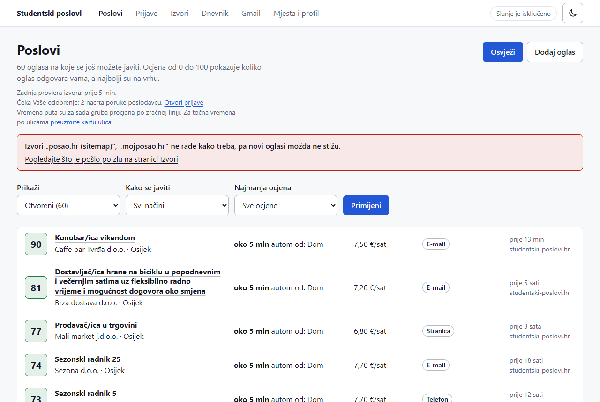
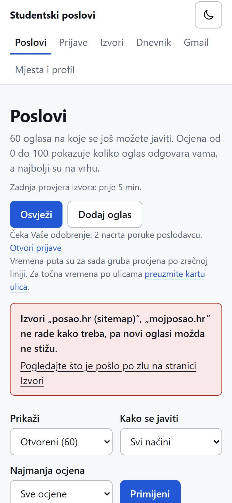
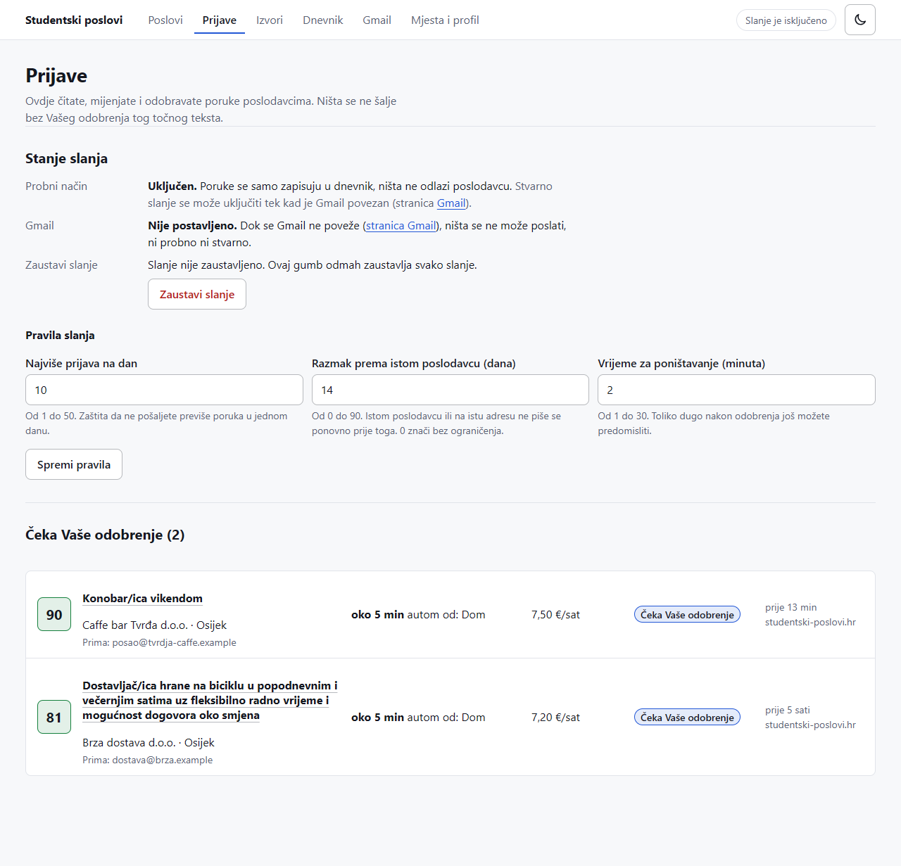
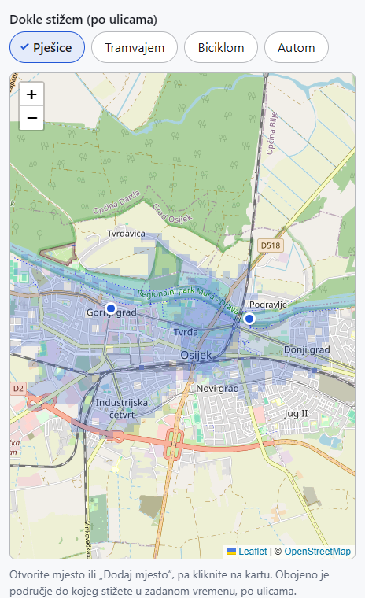

# Student Job Assistant

A local web app that collects student jobs in Croatia (starting with Osijek), scores each ad from 0 to 100 with plain-language reasons (job type, pay, freshness, travel time from home), and alerts you on Gmail and on your phone with the ad and a drafted application email, or the phone number or link. **Nothing is ever sent to an employer until you approve that exact text.**

It runs on your own Windows PC (FastAPI, SQLite, server-rendered pages) and is not hosted anywhere. If the PC is off or asleep, nothing runs. The UI text is Croatian; the code and this documentation are English.

| | |
|---|---|
|  |  |
|  |  |

*Real pages of the running app on invented demo data. Map data (c) OpenStreetMap contributors (ODbL). More pictures and an honest status table: [docs/showcase/SHOWCASE.md](docs/showcase/SHOWCASE.md).*

## What works today
- Scoring with reasons, de-duplication, contact extraction (email, phone, link).
- One job site collected directly (studentski-poslovi.hr, polite: robots.txt, crawl delay); any other ad can be pasted in.
- Gmail alerts and a phone push (ntfy) for good new ads, with quiet hours and digests (test messages are confirmed on the author's phone; the first alert for a brand-new real ad is still to be seen).
- Travel times over real streets (walk, bike, car, tram) from a one-time OpenStreetMap download; ads that name only a town are not given invented minutes.
- Drafted application emails in Croatian, an approval queue, and a send gate that refuses anything not approved (undo window, daily cap, per-employer pause, kill switch; trial mode is on by default).
- Reads GPP Osijek's public tram and bus timetables on your own PC and joins the bus boards to the map's bus lines.
- Automated tests and CI on every push.

## What does not work yet
- Real bus and tram times are not in the scores yet (the timetable is read and matched, the door-to-door calculation is next).
- Approving by replying "DA" to an alert is built and tested with simulated mail, but not yet tried with a real reply.
- Reading job-alert emails from Gmail, reply tracking, the "employer confirmed" reminder email, a security review and learning from replies are not done.
- Only one job site is collected directly.

The full list with the plan step of each item is in [docs/showcase/SHOWCASE.md](docs/showcase/SHOWCASE.md).

## Setup (once)
```bash
python -m venv .venv
.venv/Scripts/python -m pip install -e ".[dev]"
.venv/Scripts/python -m alembic upgrade head          # creates data/jobs.db
# put your CV PDFs in data/cvs/ (Croatian file name contains "Životopis", English one "CV")
.venv/Scripts/python scripts/seed_profile.py          # registers the CVs, tone "Vi"
```

## Run
**Easiest: double-click `start.bat`** in this folder. A black window opens and the page opens in your browser at http://127.0.0.1:8765. Keep the black window open; closing it stops the app. (The first time it prepares itself, which takes a few minutes.)

Or by hand:
```bash
.venv/Scripts/python -m uvicorn app.main:app --host 127.0.0.1 --port 8765
```
Open http://127.0.0.1:8765/health.

To look around **with invented data only** (no Gmail, no websites contacted), see "How to run it" in [docs/showcase/SHOWCASE.md](docs/showcase/SHOWCASE.md).

## Connect Gmail (once, to get alerts on your phone)
Open the **Gmail** page of the app and follow its steps: turn on 2-step verification in your Google account, make an *app password* (16 letters, only for this app), paste it into the box on the Gmail page. The app checks it with a real login and keeps it only in Windows Credential Manager (never in a file, the log or git). Then press "Pošalji probnu poruku sebi", say whether your phone buzzed, and switch the alerts on. You can cancel the app password any time in your Google account. Nothing is sent to employers from this page.

## Tests
```bash
.venv/Scripts/python -m pytest -q
.venv/Scripts/python -m ruff check .
```
This public copy leaves out the tests that need saved pages of third-party websites (studentski-poslovi.hr and GPP Osijek's timetable pages, which are not republished here); the author's private repository has them.

## Credits and licence
Code: [MIT](LICENSE). Map data and street routes: (c) OpenStreetMap contributors, ODbL. Maps in the browser: [Leaflet](https://leafletjs.com) (BSD-2-Clause, its licence is in `app/web/static/vendor/leaflet/`). The app reads GPP Osijek's published timetables only on the user's own PC and at most once a day; the times are not shown anywhere yet, and when they are, GPP's copyright notice (kept in `app/geo/gpp_store.py`) goes with them. It is not affiliated with GPP Osijek or studentski-poslovi.hr.
